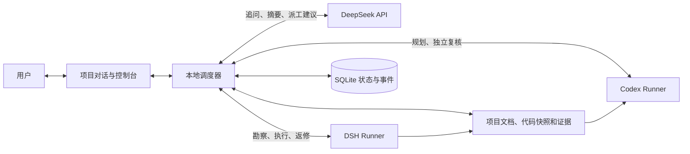

# 多 Agent 项目推进程序 · 总体方案

DeepSeek 负责收集需求、追问和派工。DSH 负责勘察、执行和返修。Codex 负责制定方案与独立复核。本地程序负责项目状态、文件版本、任务调度与放行。用户在同一个项目窗口提出需求、看进度、补充信息和批准关键动作。

DeepSeek 可以替用户整理上下文并向两个 Agent 发起下一轮对话。程序将发送者标记为「项目调度器」，保留原始用户指示和派工依据。只有真实用户的操作可以改变授权，只有满足验收条件的那份交付可以进入下一阶段。

## 1. 接入方式



| 组件 | 首版接入 | 启动前需确认 |
| --- | --- | --- |
| DeepSeek 协调器 | Responses API 输出结构化的追问、派工或暂停建议。程序维护本地会话上下文，校验 JSON 和建议适用的项目版本后再执行 | 用实际账号验证可用模型、思考档位、结构化输出与限流；如账号只支持 Chat Completions，在适配器内处理格式差异 |
| DSH 执行器 | `dsh headless` 从标准输入接任务，JSONL 返回事件，按 `session_id` 续接。勘察和实施使用不同权限配置 | 验证 `--patch` 能应用选定模型和 `reasoningEffort`，验证会话续接、事件字段和进程终止行为 |
| Codex 规划与审核 | `codex exec` 使用结构化输出和事件流。每次正式复核建立独立上下文，输入固定基线、交付和验收标准 | 验证模型和思考档位实际可用、输出 schema、只读检查与工作区权限；需要实时控制或动态模型列表时接入 App Server |

项目窗口展示三个角色的任务对话和结果。程序用原生接口把任务送进 Agent 会话，项目文档和事件流保存在本地，关掉窗口后后台仍能运行。每个角色可以设默认模型和思考档位，每阶段可覆盖，修改从下一次任务开始生效。保存请求值、实际值和验证状态。模型不可用时暂停并展示可选项。首次验证也要确认切换真的生效。

本机已确认 DSH `0.2.2-rc.3` 和 Codex CLI `0.169.0-alpha.11.1` 提供上述命令入口。当前核查范围是版本、帮助和配置结构。真实账号、引擎权限和端到端续跑留在 P0 验证。通过验证后锁定接入版本，并用样例事件做兼容回归。 [DeepSeek Responses API](https://api-docs.deepseek.com/guides/responses_api/) · [DeepSeek 模型列表](https://api-docs.deepseek.com/api/list-models/) · [Codex 非交互模式](https://learn.chatgpt.com/docs/non-interactive-mode) · [Codex App Server](https://learn.chatgpt.com/docs/app-server)

## 2. 从需求到交付

| 工序 | 做什么 | 何时继续 |
| --- | --- | --- |
| 1. 建档和追问 | 程序收下第一条需求就创建项目目录。DeepSeek 维护目标、范围、交付物、验收口径、依赖和待确认项，每轮优先问影响最大的 1–3 个问题 | 关键问题已有答案，需求形成带版本的快照。允许低风险假设随档记录。用户可在提交需求时允许对满足条件的需求自动定稿 |
| 2. DSH 勘察 | 根据需求和授权范围读取目标环境，记录仓库、版本、部署拓扑、运行状态、测试入口、权限限制和缺失资料。事实附采集时间与证据，推测单独标识 | 已获取规划所需的环境事实。关键证据缺失时请用户补齐，受限时可用经确认的脱敏快照 |
| 3. Codex 规划 | 打包需求和勘察快照。Codex 写总体方案、阶段依赖和阶段执行文档。每阶段有步骤、输入、交付物、验收项、证据和恢复方法。DSH 可只读核对执行可行性，发现问题由 Codex 更新方案 | 调度器确认阶段依赖可解析、验收项有验证入口、实施目标明确。普通阶段可自动启动，高影响动作另有授权记录 |
| 4. DSH 实施 | DeepSeek 把当前阶段、必要上下文和前置交付发给 DSH。DSH 在授权工作区内执行、验证和提交候选结果，明确记录未验证或延期的事项 | 候选提交或文件清单已固定，交付与测试证据齐备，进入复核 |
| 5. Codex 复核 | Codex 读取需求和验收标准，对照候选实现、差异、命令结果和证据。报告逐项给出已验证结论、问题及其位置、仍待核验的地方 | `PASS` 还须通过程序放行检查。`CHANGES_REQUESTED` 按问题 ID 自动返修。`NEEDS_EVIDENCE` 自动补齐范围内的证据，`BLOCKED` 进入待处理队列 |
| 6. 推进和交付 | 放行后记录通过的版本、证据和时间，并派发下一个前置条件满足的阶段。最后生成交付摘要，交代部署状态、待办和使用或恢复入口 | 所有必做阶段和项目级验收通过后，整体交付。延期事项保留原状态和负责人 |

**返修按问题编号闭环。** DeepSeek 派单时引用 Codex 的问题、证据与本轮候选版本。DSH 提交逐项响应和新候选。Codex 验证已修问题，以及改动影响到的验收项，并对新候选出具结论。首版默认按阶段串行推进，每阶段最多三轮返修，轮次可配置。连续出现同一问题且缺少可核验进展时提前暂停，供用户决定补资料、改方案或延长预算。

**需求变更生成新版本。** 运行中收到新要求时，先写入变更记录。受影响任务在安全点暂停，由 Codex 标出需重做的阶段与验收项。程序使依赖旧需求、计划或候选版本的验收及授权失效，保留历史记录供复盘。

## 3. 文档、对话与任务合同

```text
<项目名>-<project_id>/
  README.md                 项目入口和当前文档版本
  requirements/             需求快照、确认记录和变更
  environment/              勘察报告与环境指纹
  plan/                     总体方案和阶段依赖
  stages/                   阶段执行文档和返修任务
  reviews/                  独立复核与逐项结论
  evidence/                 验收证据和可追溯的文件清单
  workspace/                执行工作副本和临时验证目录
  progress.md               调度器生成的进度和续接日志
```

Markdown 供人和 Agent 阅读，SQLite 保存任务状态、审批、版本索引和事件。程序通过统一标识将聊天消息与文档、任务、结果关联。段落中的“已完成”保留为报告原文，进度以程序记录的状态为准。通过放行检查后，`progress.md` 才新增一条 `时间－P1 xxx已完成`，并附候选版本和复核链接。

每次派发都保存以下字段。任务重派用新 `run_id`，原任务的证据和结论仍然可查。

| 字段 | 作用 |
| --- | --- |
| `project_id`、`stage_id`、`task_id`、`run_id`、`attempt` | 区分项目、阶段、任务与执行轮次，支持去重和续跑 |
| `requirement_rev`、`plan_rev`、`input_manifest` | 固定需求、计划和输入文件版本。清单列出相对路径、摘要及保密级别 |
| `target`、`base_ref`、`candidate_ref` | 固定目标、实施基线和候选。代码使用提交号，文档和非 Git 交付用带哈希的清单 |
| `allowed_ops`、`approval_ref`、`limits` | 限定可读写的位置、可操作对象，以及时间、花费和轮次预算 |
| `criteria`、`result_schema` | 声明各验收项需要的证据，以及结果和复核结论的字段 |

Agent 结果包含状态、产物、逐项测试结果、证据位置和未验证项。复核结果再增加 `candidate_ref`、问题编号、严重度与验收项结论。程序先验证结构，再检查文件和哈希。DeepSeek 只收到协调所需的摘要与相关片段。DSH 和 Codex 按任务清单读取所需文档；需要跨机器交接时才生成带清单的压缩包。需求附件、终端日志和勘察材料作为待分析数据，其内容没有调度或授权效力。密钥放在任务环境或本机凭据存储，交付包和聊天上下文使用脱敏数据。

## 4. 自动放行和人工授权

一个阶段进入「已验收」须同时满足四个条件。

1. 前置阶段有效，当前需求、计划、环境与候选版本符合派工基线。
2. 必交产物可读取，证据匹配同一个候选和验收环境。可机器执行的检查由程序直接验证，复核员验证其余证据。
3. Codex 对该候选给出 `PASS`，且必验项全部通过。延期验收须有已确认的范围变更或有权人接受的例外记录。
4. 对需要授权的操作已有对应授权和执行结果，且审查发现的阻塞事项都已关闭。

日常开发、临时测试和文档更新可在事先授权的范围内持续执行。生产切换、生产数据批量修改或删除，以及超出原范围的操作进入用户待办。授权绑定操作类型、目标、方案版本、影响范围与时限。程序派工前复核前置条件，版本或目标变化时回到待授权。授权记录和执行证据跟随任务，方便接手的人判断实际完成到哪一步。

DSH 是实施写入者。Codex 复核时读取固定候选，执行测试需要写入时使用独立的临时副本。DeepSeek API 不持有机器或数据库凭据，派工建议由调度器校验。Runner 只接收调度器生成的任务，根据目标和角色配置真实的本机或远端权限。

以 A2 的 P2 为例，勘察、图存储适配、迁移演练和生产切换应有各自的验收项。前三项可以各自留存验收结果，生产切换仍显示「待授权」或「未执行」。如果切换属于必做项，整个阶段仍在等待。日志中的结论要能定位到候选版本、演练环境和实际执行的命令结果。

## 5. 长任务、崩溃恢复和并发

- **任务状态。** 排队、运行、待用户补充、待授权、暂停、失败、结果待核实、待复核和已验收均可从控制台查看。切换阶段前先落盘，程序重启后按状态继续。模型的回答、CLI 退出和产物校验分别记录。
- **幂等派工。** 用 SQLite 事务先记派工意图，再由 Runner 领取运行票据。每次运行带唯一标识，重复或过期事件保留审计并排除出状态推进。收到迟到的旧版 `PASS` 时只归档。
- **独占写入。** 同一工作副本或写入目标一次只分配一个执行者。获准并行的独立阶段使用隔离工作副本。进程失联时先核实运行是否终止和目标是否被写入，资源确认可用后才发给下一位执行者。
- **恢复过程。** 已知上传失败、限流等暂时错误可限次退避。程序崩溃后，从会话 ID、运行日志、Git 提交和目标回执重建结果。外部操作结果不明时进入「结果待核实」，先查询实际状态，再决定补偿或重试。
- **数据库任务。** 涉及批量变更时，执行脚本需要可恢复的操作编号和批次回执。适用时让每批业务变更与回执在同一事务中提交，避免重试重复写入。回滚与恢复步骤、影响量和验收查询写进阶段档案。断开本地会话后，远端任务需通过可核验的取消或恢复接口处置。
- **暂停和预算。** 支持暂停项目、取消当前轮次与恢复。超出时间、花费或返修预算时保持当前证据，停止派新任务；不可中断的受权操作走执行器定义的安全停止流程。

## 6. 实施路线与验收

首版使用本机 Python 调度进程、SQLite、JSON Schema 和两个 CLI Runner。先用项目命令与 Markdown 交付验证闭环，再加入本地控制台与后台服务。

| 阶段 | 具体步骤 | 验收 |
| --- | --- | --- |
| P0 接口验证 | ① 用固定夹具探测三方模型和思考档位 ② 验证 stdin、结构化结果、会话 ID、续跑及取消 ③ 验证只读和写入边界 | 三方各跑通一次最小任务，保存实际配置与事件样例。能区分正常完成、失败和未知结果 |
| P1 调度内核 | ① 建项目结构、版本清单和状态机 ② 用模拟 Agent 实现追问、派工、审核和返修 ③ 加入锁、恢复和日志 | 人为打断进程，验证恢复时不会重复派发写任务。发送重复事件或旧候选的 `PASS`，确认均无法错误放行 |
| P2 真实三方闭环 | ① DeepSeek 收集一个小型非生产需求 ② DSH 勘察，Codex 写总体和阶段方案 ③ DSH 交付，Codex 审核并验证返修 | 选择可确定地触发一次验收失败的样例，观察「复核发现问题 → DSH 修复 → 新版本通过 → 自动派发下一阶段」的完整链路 |
| P3 可用性 | ① 接入中央 DeepSeek 对话和项目进度 ② 接入左右 Agent 会话及证据查看 ③ 加角色模型配置、待办、审批和预算 ④ 验证窄屏、重连及多项目隔离 | 用户能独立建档、答疑、选档、切换并对照 Agent 会话、处理待办及恢复任务。详细验收见第 7 节 |
| P4 复杂项目演练 | ① 用 A2 历史材料或副本回放计划、复核和收口 ② 在隔离数据库演练分批提交、中断和恢复 ③ 核对授权、审计与交接 | 可从日志说明每个阶段的已完成、待授权和待核实事项。故意中断批次后能核对实际结果并恢复，生产切换始终由独立授权驱动 |

P2 可用一个临时 SQLite 导入工具做样例。用户只提出「导入 CSV」，由 DeepSeek 追问重复行如何处理。需求明确后，把「同一文件导入两次只产生一份记录」写成验收项。给流程一版已知会产生重复记录的候选，Codex 找到并复现问题，DSH 修复后重新提交。专项检查和复核都通过后，程序派发下一阶段。整个样例只需要本地夹具。

最小可用版本以 P2 通过为准。它交付一条可在本地实际运行的链路，能追问、派工、审查返修和自动续跑。P3 提供日常使用界面，P4 验证复杂软件和数据库项目的执行边界。

## 7. 前端工作台

采用中央 DeepSeek 对话和两个可展开的 Agent 面板。中央用于提需求、答疑、安排任务和处理决策。左右面板各自选择想看的 Agent 和会话，默认左侧显示 DSH、右侧显示 Codex。能够交换顺序、同时看同一个 Agent 的两轮会话，或选择以后接入的其他 Agent。移动面板只改变阅读布局。

```text
项目切换     当前阶段 / 状态       待处理 2       暂停 / 恢复
┌─────────────────┬──────────────────────────┬─────────────────┐
│ DSH ▾  跟随 ▾    │ DeepSeek · 项目协调       │ Codex ▾  固定 ▾  │
│ 当前实施 · 第 2 轮 │ 需求、派工摘要、阶段决定    │ 第 1 轮复核        │
│ 派工原文、回复     │                          │ 审核意见、证据链接  │
│ 任务结果与产物     │ 输入需求或回复追问         │ 问题和验收项       │
└─────────────────┴──────────────────────────┴─────────────────┘
      需要时展开文件抽屉查看阶段文档、交付差异或验收证据
```

### 7.1 对话、任务与证据

- **中央对话。** 保留用户输入、DeepSeek 的追问与答复，以及关键派工、验收和阶段变更。普通事件合并成任务卡片。派工卡片可以在任一侧打开对应会话，问题和证据链接可以追加到中央输入框，方便用户追问。消息区分「你」「DeepSeek」「项目调度器」和具体 Agent。
- **两侧各自选 Agent 和会话。** 「跟随当前任务」时显示所选 Agent 正在执行的任务，空闲时显示最近一轮。向上翻看时保持阅读位置，手动选择历史会话时固定在该轮。会话标题显示阶段、轮次、候选版本和运行状态。面板展示派工原文、Agent 回复和交付事件，命令输出和完整事件按需展开。
- **版本对照。** 例如左侧固定 DSH 的第二轮交付，右侧固定 Codex 针对第一轮候选的审核。若两侧版本不同，面板直接显示各自的版本，审核卡片可打开对应候选。只有调度器确认的验收状态才出现在顶部阶段条。
- **折叠和恢复。** 面板可独立折叠、拖动宽度，折叠后仍有新回复和阻塞提示。窄屏默认显示中央对话，左右会话通过抽屉切换。各项目的布局及会话选择在本机保存，重新打开后可接着看。

### 7.2 设置和控制

- **项目设置** 管理参与的 Agent、角色、默认模型、思考档位、阶段覆盖和预算。可查看本轮实际配置，新配置从后续运行起生效。面板选择和执行角色分别保存。
- **待办** 汇总需要用户回答的问题、待授权操作和需核实的失败。审批卡显示实际目标、操作及所依据的方案版本，由用户确认，刷新后仍能查看授权记录。中央对话也可以打开同一张卡片。
- **后端驱动状态。** 工作台通过本地接口读取项目快照、会话和证据，订阅后端运行事件。首版可用 SSE 推送，以事件序号补齐刷新或断线期间的记录。输入、暂停、恢复和授权都提交给调度器处理。新接入 Agent 提供会话、角色、模型能力和统一事件，前端用同一套面板渲染。

### 7.3 前端验收

1. 左右面板可以独立切换、互换、同时查看同一 Agent 的不同历史轮次。切换布局时运行中的任务继续执行。
2. 一侧跟随 DSH 的最新返修，另一侧固定 Codex 原审核，能从任意会话定位派工、产物和对应候选版本。
3. 两侧折叠时中央仍能接收进度。刷新或短暂断线时后台继续执行，重新连接后任务状态一致，历史消息无丢失或重复。
4. 用户在中央完成一次需求追问与一次授权，能查看结果和记录。模型和思考档位的修改只影响后续任务。
5. 用模拟的新 Agent 验证可选、可显示回复和状态。窄屏切换会话时保持各面板的选择和阅读位置。
